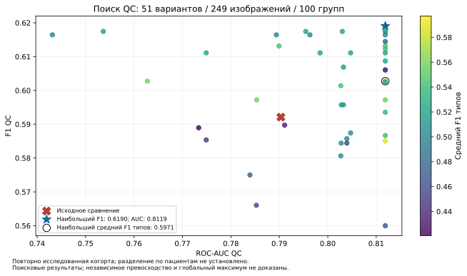

# Анатомия, следующие итерации QC и проверка поставки — 15.10.2026

Продолжение после первых трёх итераций: выполнены ещё 40 вариантов QC, обучены
несколько сетей ориентиров бедра, сеть проекции и адаптация ROI. Проверены CPU- и
GPU-контейнеры на полном архиве организатора через CLI и настоящий HTTP.
Новые модели пока исследовательские.
Все требования ТЗ ещё не закрыты: автоматическая анатомия и проекция требуют
доработки; ни глобальный максимум метрик, ни результат закрытого теста не установлены.

Машиночитаемые результаты, хеши источников, протоколы и ограничения:
[anatomy_upgrade_2026_10_15.json](competition/anatomy_upgrade_2026_10_15.json).
Исходный объём требований разобран в
[повторном чтении ТЗ](TASK_SOURCE_RECHECK_2026_10_15_RU.md).

## Измеренные метрики

249 размеченных изображений, 100 групп исследований, 73 нарушения. Для новых
обучаемых голов сохранены пять внешних и четыре внутренних разбиения по
исследованиям. Группа исследования не доказывает разделение по пациентам.
Маршрутизация области остаётся исторической. Этот набор уже многократно
исследован: все сравнения являются поисковыми, а не новой независимой проверкой.

| Вариант | F1 QC | ROC-AUC | Средний F1 типов | TN / FP / FN / TP |
|---|---:|---:|---:|---|
| Исходное сравнение | 0,5921 | 0,7903 | 0,4818 | 142 / 34 / 28 / 45 |
| Маски позвоночника + прежняя ранжирующая голова | 0,6111 | 0,8119 | 0,5240 | 149 / 27 / 29 / 44 |
| То же + видимость Th12/гребней | 0,6164 | 0,8119 | 0,5016 | 148 / 28 / 28 / 45 |
| Ось по L1–L4 + прежняя ранжирующая голова | 0,6122 | 0,8119 | 0,5440 | 147 / 29 / 28 / 45 |
| Ось L1–L4 + видимость Th12/гребней | **0,6174** | **0,8119** | 0,5216 | 146 / 30 / 27 / 46 |
| Более чувствительный вариант с общей головой | 0,6145 | 0,8119 | 0,4702 | 134 / 42 / 22 / 51 |
| Геометрия ROI только для её типа | 0,6027 | 0,8119 | **0,5971** | 147 / 29 / 29 / 44 |
| Общий порог QC + новый блок ROI | **0,6190** | **0,8119** | 0,5363 | 133 / 43 / 21 / 52 |

У сбалансированного варианта с F1 0,6174 на одно пропущенное нарушение меньше и на четыре
ложных срабатывания меньше исходного сравнения. Его 95% интервал F1 при
бутстрэпе исследований — 0,5224–0,6962. Это не доказательство устойчивого
превосходства. Не существует заданной организатором формулы, позволяющей
однозначно свести F1, AUC и типизацию в один итоговый балл.

Вариант с наибольшим общим F1 0,6190 пропустил 21 нарушение вместо исходных 28,
но дал 43 ложных срабатывания вместо 34. Его чувствительность 0,7123,
специфичность 0,7557; 95% интервал F1 0,5255–0,7033. Самый высокий средний
F1 типов 0,5971 получен другим вариантом с общим F1 0,6027. Геометрия ROI
подняла F1 соответствующего типа с 0,4615 до 0,7273; её применение к блоку
укладки ухудшало этот блок, поэтому проверено раздельное назначение признаков.
Эти результаты описывают разные компромиссы; одновременного максимума
всех показателей не установлено.

Попробованы геометрия масок, отдельная ось L1–L4, анатомическое объединение
патчей DINO, общая голова QC для обеих областей, смеси с прежними головами,
бутстрэп порогов и общий порог QC перед типизацией. Последний повышает
чувствительность ценой ложных срабатываний и ошибок типа. Улучшения на одном
показателе не выдаются за улучшение на всех показателях.

Дополнительно проверены три фиксированных варианта с повторным кодированием
проксимальных фрагментов бедра (120 мм и отступ 20 мм) двумя энкодерами.
Масштабирование выполняется в пределах исходного поля, без дорисовки.
Общий F1 варианта с порогом QC остался 0,6190, средний F1 типов снизился
до 0,4903; независимые типы дали F1 0,6131. Этот блок не выбран для поставки.

Отсутствие требуемой структуры в предсказанной маске хранится как свидетельство
модели с необходимостью проверки. Технический отказ сегментации не подменяется
анатомическим дефектом. Отступы поля сканирования не подменяют корректность ROI:
на имеющихся положительных примерах это разные признаки.

## Анатомическая ветка

Загружены и проверены контрольные суммы весов
[TotalSegmentator2D](https://github.com/risc-mi/totalsegmentator2D),
[TSXR-V2-R001](https://zenodo.org/records/17052912). Они предназначены для
анализа проекционной анатомии; здесь проверяется перенос на DXA. Лицензия весов
CC-BY-NC-4.0 должна учитываться при дальнейшей поставке этих исследовательских весов.

Собраны 179 признаков позвоночника и 56 признаков бедра. В 99 изображениях
позвоночника модель дала упорядоченные кандидаты L1–L4; Th12 обнаружен в 98,
левый и правый гребни — в 96 и 95. Это количества предсказаний, а не точность.
Для бедра исходный и зеркальный проходы сегментации дали пригодный вход
сети ориентиров на 149 из 150 изображений, недегенеративную ось шейки на 147.

Для ориентиров использованы опубликованные 3D модели и разметка пяти экспертов
[VSDFullBodyBoneModels](https://github.com/RWTHmediTEC/VSDFullBodyBoneModels)
на закреплённом коммите. Обучение: 15 доноров, проверка: четыре ранее
просмотренных донора. Проекции являются синтетическими силуэтами. У сети с
нормализацией физических размеров средняя ошибка большого вертела 2,58 мм,
малого вертела 3,07 мм, центра головки 0,58 мм, центра перешейка 1,80 мм;
ошибка оси 3,01°. Эти числа не являются точностью ориентиров на DXA.

На десяти опубликованных Hologic DXA центр предложенной шейки попал в
издательскую ROI кости в девяти случаях; средний Dice предложенной ROI 0,658.
Но полнота маски бедренной кости относительно издательской total-ROI только
0,480. Следовательно, полная сегментация бедра ещё ненадёжна. На этих данных
используется масштаб устройства по умолчанию, поэтому точность в мм не заявляется.

Следующая адаптация ROI обучает четыре параметра в предсказанной системе
координат шейки. При исключении проверяемого DICOM-исследования из обучения
средний Dice вырос с 0,6577 до 0,6809 на тех же десяти папках. Издательская ROI
не является независимой разметкой оси шейки или всего контура большого вертела.

Отдельно построены 665 синтетических видов с независимым поворотом камеры
относительно передней плоскости таза и поворотом ноги вокруг механической оси.
На 60 фронтальных/боковых видах четырёх удержанных доноров F1 и AUC равны 1,0.
Это точность только на синтетических крайних ракурсах. На DXA модель дала
149 доступных оценок из 150, три из них отнесла к боковому синтетическому
классу; истинной разметки проекции для проверки этих ответов нет.
Добавление этого признака в QC снизило F1 до 0,5867. Три варианта нелинейной
головы SVM также не улучшили прежний AUC: 0,7537 / 0,8030 / 0,7955.

Реализованы предложения межпозвоночных маркеров по минимумам проекционной
плотности (§2.6, рис.7 методички). На десяти опубликованных DXA доступны 39
из 40 предложений ROI; средний Dice с полной измерительной ROI издателя 0,5586,
с областью кости — 0,5378. Маркеры являются предложениями границ,
не подтверждённой сегментацией дисков; качество ещё требует улучшения.

PNG-корпус с названием Chinese DXA не использовался для нового обучения QC:
его модальность не подтверждена, просмотренные примеры похожи на обычные
рентгенограммы. Название набора не является доказательством модальности.

Три последующих обучения использовали 225 видов 15 доноров и 60 видов четырёх
удержанных доноров с отдельно заданными поворотами камеры и ноги. На тех же
контрольных видах контекст таза снизил среднюю ошибку оси с 2,192° до 1,695°,
ошибку малого вертела с 2,578 до 1,294 мм. На опубликованных DXA Dice
адаптированной ROI почти не изменился: 0,68094 → 0,68141. На 150 изображениях
организатора доступность предложений ROI выросла с 146 до 147. Вариант
с морфологическим шумом был хуже на синтетическом контроле и не выбран.
Проверка поворотов на 180° и заполнения замкнутых отверстий не устранила
остальные отказы. Их нельзя выдавать за исправленную локализацию.

## Инференс из исходных DICOM

В новом прототипе признаки повторно вычислены из пикселей DICOM: TSXR,
геометрия, DINO и RAD-DINO. Используются сохранённые обученные головы и
пороги; метки и сохранённые признаки изображений инференсу не нужны.
Изолированный сетевой namespace имел только интерфейс lo.

Первый прогон отклонён проверкой: идентификаторы папок разбиения и
обезличенные DICOM StudyUID принадлежат разным пространствам имён, поэтому
неверно выбирался ансамбль вместо удержанной головы. Метрики этого прогона
не используются. Затем построена проверенная биекция: 100 групп = 100 StudyUID,
249 размеченных пиксельных идентичностей, пересечений между группами/фолдами нет.

Исправленный прогон: 499/499 файлов успешно, 252 уникальных вычисления,
110,22 с на пакет, консервативная верхняя граница на исследование 21,55 с.
Все 249 классов, типов и областей совпали с сохранённым расчётом варианта
«маски позвоночника + прежняя ранжирующая голова»: F1 0,6111, AUC 0,8119,
максимальное расхождение вероятности 2,22e-16.

Следующий сырой прогон уже включал ось L1–L4 и правило гребней: 499/499 файлов,
F1 0,6174, AUC 0,8119. Все 249 классов и типов снова совпали с сохранённым
расчётом; расхождение вероятности не более 2,22e-16. Пакет занял 119,21 с,
верхняя граница на исследование 22,05 с в пределах batch-процесса.
Архив исходника этого запуска сохранён и связан с протоколом хешем.
Ансамбль пяти голов для новых исследований не имеет независимой оценки
на обучающей когорте; его успешный запуск нельзя считать новым измерением F1.

Схема с общим порогом QC и новым блоком ROI тоже воспроизведена из DICOM
без сети: 499/499 файлов, 252 уникальных вычисления, 249/249 совпадений классов
и типов с сохранённым расчётом, F1 0,6190, AUC 0,8119. Пакет занял 127,18 с,
верхняя граница на исследование 23,47 с; это отдельный исследовательский
запуск, отличный от проверенного ниже снимка GPU-контейнера.

Для поставки обучены отдельные головы на всех 249 размеченных изображениях;
пороги взяты из внутренних четырёх разбиений по исследованиям. Они не
оцениваются на обучающих данных. Полнообученный артефакт отклоняется
инструментами удержанной проверки и не может маскироваться под OOF.
В оценке качества сохранён отдельный вложенный протокол с удержанием
исследований. Точность конкретных полнообученных весов на новом наборе
ещё не установлена.

## Контейнер и поставка

Проверен отдельный CPU-образ неизменённого профиля 1.11.6. Он не содержит новые
исследовательские анатомические головы. Отсутствие доступа к системному Docker
обойдено локальным rootless Docker без изменения системной конфигурации.
В Dockerfile исправлено отсутствие пакета gpu_research, нужного проверочным
скриптам; run.sh учитывает соответствие пользователей rootless namespace.

| Проверка без сети | Результат |
|---|---|
| CLI, исходный ZIP организатора | 499/499, 0 ошибок; CSV соответствует формату |
| CLI, пакет / верхняя граница на исследование | 86,77 с / 26,56 с |
| HTTP multipart ZIP → очередь → скачивание | 499/499, ответы совпадают с CLI |
| HTTP, пакет / верхняя граница на исследование | 82,15 с / 25,11 с |
| Интерфейс | два собранных UI-ресурса реально отдаются HTTP-сервером |
| Экспорт | CSV, XLSX; 499 PNG, 499 DICOM SC, 499 DICOM SR |
| Целостность | исходный ZIP сохранён побайтно, выходные архивы проверены |
| Сеть контейнера | network=none, только lo |
| Тесты снимка контейнера | 431 passed, 8 skipped |
| Тесты текущих исходников | 463 passed, 5 skipped |

Времена измерены на локальной машине, не на целевой H200. Снимок контейнера
проверен до последних добавлений исследовательских скриптов; хеш его образа
сохранён в JSON. Эта таблица относится к CPU-поставке, а следующий раздел —
к отдельно собранному исследовательскому GPU-кандидату.

## Самостоятельный GPU-образ и HTTP

Создан отдельный образ `dxaqc:anatomy-research-20261015`:
`sha256:6eb8ef989cd29368cbb440f0d19823774cabd410838594d91cb50984878b225f`.
В нём локально находятся код, энкодеры, сегментаторы, головы QC и пороги,
сеть ориентиров, сеть проекции и адаптация ROI. В финальные слои образа
не включены таблицы обучения, QC-метки и кэш признаков. Экспорт голов
проверен отдельным тестом: обучающие массивы удаляются, предсказания
сохранённых моделей остаются теми же. Закреплены 114 зависимостей
отдельного GPU-окружения; CPU-окружение 1.11.6 не изменено.

| Проверка GPU-образа, network=none | Результат |
|---|---|
| Аппаратная проверка | RTX 4070, Torch 2.7.1+cu128, реальное вычисление CUDA |
| CLI | 499/499, 0 ошибок; валидная таблица; пакет 199,43 с |
| CLI, верхняя граница на исследование | 24,18 с; с инициализацией моделей 36,89 с |
| HTTP multipart ZIP → очередь → скачивание | 499/499, ответы совпадают с CLI |
| HTTP, пакет / верхняя граница на исследование | 220,48 с / 37,35 с |
| Экспорт | CSV, XLSX, 499 PNG, 499 SC, 499 SR; архивы проверены |
| Сеть | только lo; веса не скачиваются при инференсе |
| Исходники инференса | хеши файлов внутри контейнера совпали с исходниками проверенного снимка |

Все границы относятся к исследованию, а не ко всему архиву из 100 исследований.
Время инициализации CLI измеряет загрузку моделей; начальный импорт Python
и запуск Docker отдельно в эту величину не включены. H200 не измерялась.
Ни один результат пятиголового ансамбля из этой таблицы не выдаётся за
оценку качества на удержанных исследованиях.

На 252 уникальных вычислениях GPU-ветка дала 394 предложения ROI позвоночника
и 149 ROI бедра из 153 изображений бедра. Для четырёх изображений ROI бедра
не сформирована: один отказ локализации, одно неразрешённое сечение шейки,
две вырожденные оси. Эти отказы сохранены, вместо подстановки вымышленных координат.
Следовательно, `requirements_complete` остаётся false.

Запуск после загрузки образа, с настроенным NVIDIA Container Toolkit:

```sh
./competition/run_anatomy.sh batch datasets/organizer/НД_для_обучения.zip /absolute/output
./competition/run_anatomy.sh serve 8091
```

Для использованного локального rootless Docker проверен режим
`DXAQC_GPU_MODE=devices`: устройства GPU и библиотеки драйвера подключаются
только к контейнеру, без изменения системной конфигурации. Адрес созданного
движка хранится в `data/build-rootless/runtime-path.txt`; Docker должен быть запущен.
Режим `toolkit` используется по умолчанию для обычной настроенной GPU-машины.

Веса в Git не добавляются. Воспроизводимая упаковка:
`export_anatomy_candidate.py` → `prepare_anatomy_container_assets.py` →
`competition/Dockerfile.anatomy` с именованным контекстом `anatomy_assets`.
Команды `--help` описывают локальные входные артефакты; их хеши связаны
в манифестах. Образы CPU/GPU сохраняются в игнорируемый каталог
`data/build-artifacts/2026-10-15/`. Архив двух образов готов: 7 295 868 844 байт;
проверены SHA-256, gzip CRC и 92 адресуемых по содержимому блока.
SHA-256: `0ced0f40d22eaf1214f823b9be3616bf98d80d9a5b845033a09451e1b3c4569b`.
Повторный `docker load` не выполнялся; оба образа уже запускались после
сборки. Этот архив содержит проверенный снимок до последующих доработок.



## Оставшаяся работа по ТЗ

Обязательны реальные алгоритмы проекции, видимости анатомии, межпозвоночных
границ, ROI, ротации и физических отступов, связанные с работающим офлайн
инференсом. В исходном requirements-отчёте часть проверок жёстко зависит от
clinical_validation; внешняя клиническая сертификация не является требованием
к команде в этом ТЗ. Нужно разделить выполнение автоматической проверки и
её клиническую доказанность, сохранив честные отказы при недоступных измерениях.
Просто переключать флаги без реализации этих алгоритмов нельзя.

Следующие шаги: добавить геометрические проверки собственной ROI к признакам
QC, улучшить перенос сегментации/разметки и обработать перечисленные отказы;
разделить реализацию автоматических проверок и клиническую доказанность
в согласованном новом профиле. Офлайн GPU-инференс и HTTP уже проверены,
но anatomy_complete и требования в целом пока остаются false.
